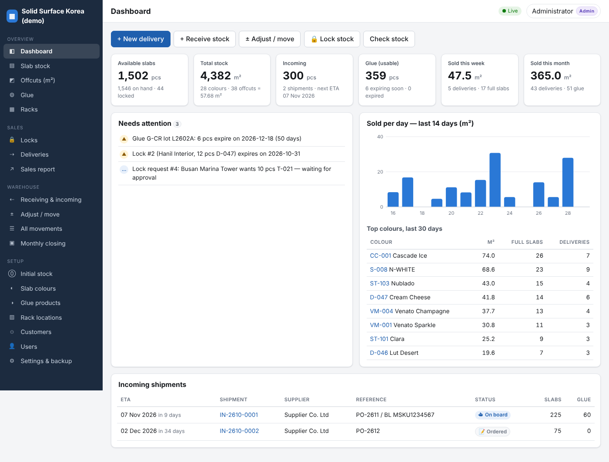
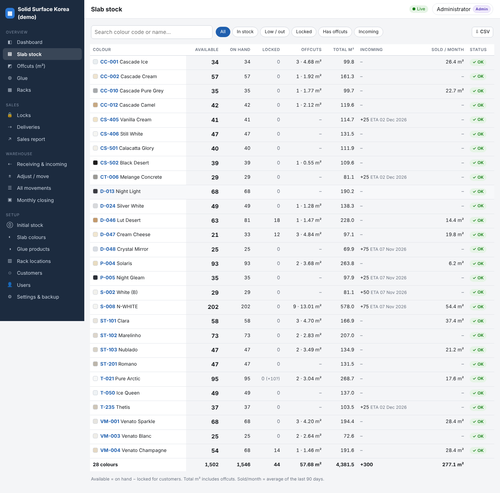
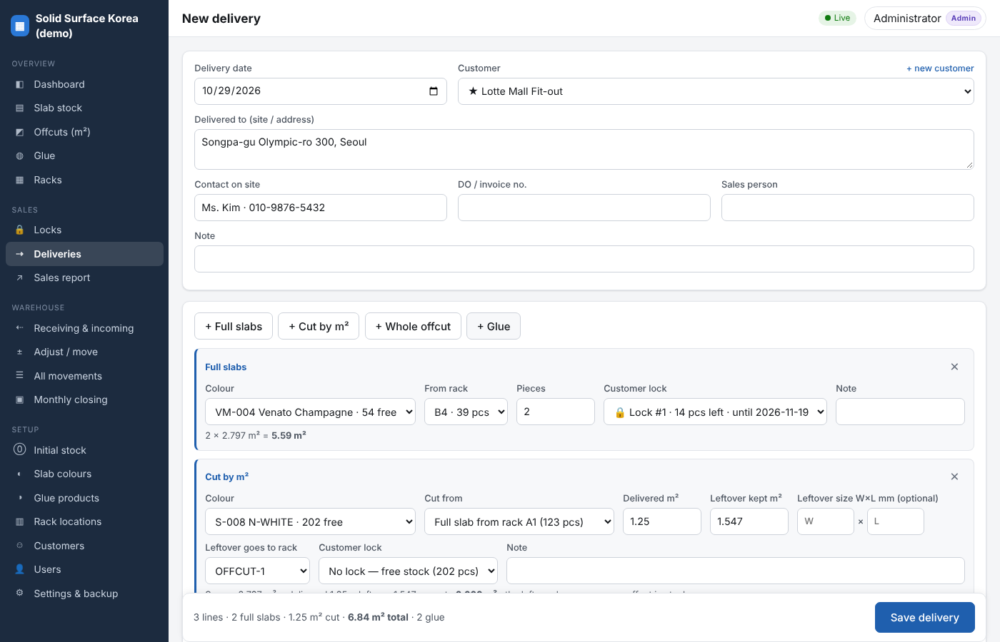
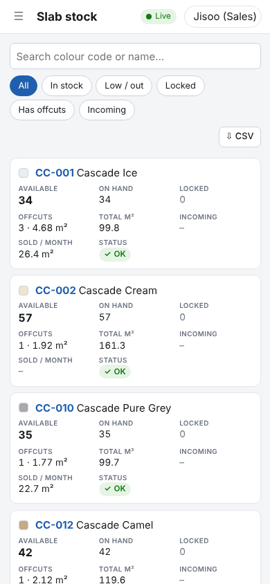

# Slab Stock Manager

A web app for managing solid surface slab stock. SCM staff record what goes in and out; sales can see the live stock from any browser or phone.

- **Slabs per colour.** Full slabs are counted in pieces per rack. Partial slabs are kept as **offcuts in m²**.
- **Deliveries by m².** When a slab is cut for a customer, the delivered area is recorded and the leftover goes back to a rack as a new offcut with its own code (e.g. `R-00040`).
- **Glue by colour.** Each glue colour is linked to the slab colours it matches. Stock is kept **per lot with an expiry date**. Deliveries take the lot that expires first and never use expired glue. Lots that are expiring or expired are flagged.
- **Customer locks.** Stock can be reserved for a customer. Sales can request a lock and SCM approves it. Locked stock can't be delivered to anyone else. Locks can have an end date, and deliveries made against a lock reduce it automatically.
- **Daily inbound and outbound.** Receipts and deliveries are recorded every day. Every delivery records **where it was delivered** (site / address), the contact, the DO or invoice number and the sales person. Each delivery prints as a delivery note.
- **Incoming shipments.** Track orders as ordered, on board or at port, with the ETA. A shipment can be received in part; whatever hasn't arrived stays listed as incoming.
- **Sales tracking** per day, week or month: m² sold, full slabs, cut m², glue, and breakdowns by colour, customer and sales person. All of it exports to CSV.
- **Monthly closing:** opening, in, out, adjustments and closing for each colour (pieces and m², with offcuts shown separately), plus glue. Closing a month freezes its figures and blocks changes back-dated into that month.
- **Initial stock entry:** one row per colour, with a rack for each, and **paste from Excel**.
- **Live updates:** every open screen refreshes within a second when someone saves something.
- Adjustments for breakage, stock counts and returns; moves between racks; a rack view; an activity log; an automatic daily backup; and a one-click backup download.

## Screenshots

| Dashboard | Live slab stock |
|---|---|
|  |  |
| **New delivery** (full slabs, cut by m², glue) | **Sales on a phone** |
|  |  |

Monthly closing: [docs/monthly-closing.png](docs/monthly-closing.png)

## Roles

| Role | Can do |
|---|---|
| **Admin** | Everything, plus managing users, closing and reopening months, settings, backups |
| **SCM** | Deliveries, receipts, incoming shipments, adjustments, rack moves, approving locks, colours, glue, racks, customers |
| **Sales** | See all stock, offcuts, glue, incoming, deliveries and reports; request locks; add customers |

## Try it (demo data)

You need [Node.js 22.13 or newer](https://nodejs.org/) (the current LTS is fine). There is nothing else to install.

```bash
npm run demo        # starts http://localhost:3000 with demo data in ./demo-data
```

Log in as `admin`, `scm` or `sales`; the password for all three is `demo1234`. The demo uses the 28 colours from the current stock sheet, plus invented deliveries, glue lots, locks and shipments.

## Start for real

```bash
npm start           # http://localhost:3000, data in ./data/stock.db
```

The first start prints an **admin password** in the console. Log in with it; you'll be asked to choose a new one.

Go-live checklist:

1. **Setup → Slab colours.** Add your colours one by one or use *Paste list from Excel* (code, name, optional size). To preload the 28 colours from the old sheet instead, run `npm run seed:colors`. That also adds example racks and glue colours, which you can edit.
2. **Setup → Rack locations.** Add your racks, e.g. `A1, A2, …`. Add one or two racks for offcuts (e.g. `OFFCUT-1`); leftovers from cutting go there by default.
3. **Setup → Glue products.** Add one product per glue colour, its shelf life, and the slab colours it matches.
4. **Setup → Customers.** Mark special customers with ★ (key account).
5. **Setup → Users.** Create a login for each SCM and sales employee.
6. **Setup → Initial stock.** Enter the physical count: full slabs per rack, offcuts with their size, and glue lots with lot number and expiry. You can save it in parts, for example one rack at a time.
7. From then on, every movement goes through *Deliveries*, *Receiving* or *Adjust / move*.

## Daily use

**SCM**
- *New delivery:* choose the customer and where it goes, then add lines:
  - **Full slabs** — colour, rack, pieces
  - **Cut by m²** — colour, cut from a full slab or an existing offcut, m² delivered; the leftover m² is filled in automatically and kept as a new offcut
  - **Whole offcut**
  - **Glue**
  If the customer has a lock on that colour, it is selected automatically.
- *Receiving & incoming:* receive stock now, or register an incoming shipment with an ETA. When it arrives, click **Receive**, check the quantities against the packing list, and enter the glue lot numbers and expiry dates.
- *Adjust / move:* breakage, stock-count differences, registering or scrapping offcuts, disposing of expired glue, and moving stock between racks.
- Approve or reject lock requests from sales under *Locks*.
- Mistakes are corrected by **voiding** the document; nothing is ever silently edited. Voiding restores the slabs, offcuts, glue and locks.

**Sales**
- *Slab stock* shows **Available** (= on hand − locked), offcuts in m², incoming quantities with ETA, average m² sold per month, and status. On phones it switches to a card layout.
- Click a colour to see its racks, offcuts, locks, incoming shipments, matching glue, monthly sales and history.
- *Request a lock* for a customer. It reserves stock once SCM approves it.

**Admin (month end)**
- *Monthly closing:* check the figures, then **Close** the month. Use *Print* or *CSV* for accounting.

## Deploying so everyone can use it

The app is a single Node.js process with a SQLite database file; there is nothing else to run.

**Option A — a PC or small server in the office.** Install Node.js, copy this folder, and double-click `start-windows.bat` (or run `npm start`). Others on the office network open `http://<that-pc-ip>:3000`. Sales outside the office would need a VPN.

**Option B — a small cloud server, recommended so sales can check stock from anywhere.** Use a cheap Linux VPS with Docker and a domain name:

```bash
# edit deploy/Caddyfile -> your domain, then:
docker compose -f deploy/docker-compose.yml up -d --build
docker compose -f deploy/docker-compose.yml logs app   # shows the first admin password
```

Caddy gets the HTTPS certificate automatically. The data lives in the `stock-data` Docker volume.

Settings (environment variables):

| Variable | Default | Meaning |
|---|---|---|
| `PORT` | `3000` | HTTP port |
| `DATA_DIR` | `./data` | Folder for the database and daily backups |
| `TZ` | system | Time zone for "today" (e.g. `Asia/Seoul`) |
| `ADMIN_PASSWORD` | random | Password for the first admin (only on first start) |
| `BACKUP_DAYS` | `30` | Number of daily backups kept in `DATA_DIR/backups` |
| `COOKIE_SECURE` | auto | Set to `1` to force secure cookies when behind HTTPS |

## Backups

- A copy of the database is written to `DATA_DIR/backups/stock-YYYY-MM-DD.db` every day, and the last 30 are kept.
- Admins can download a backup at any time under *Settings & backup*.
- Copy backups off the machine regularly (NAS, cloud drive).
- To restore, stop the app, replace `DATA_DIR/stock.db` with the backup file, and start the app again.

## Development

```bash
npm test            # API tests (stock maths, locks, offcuts, glue FEFO, void, receiving, closing, permissions)
```

- `server/` — Node HTTP server with no npm dependencies, using the built-in `node:sqlite`.
  - `docs.js` — posting rules for every movement type.
  - `stock.js` — balances, locks and glue lots.
  - `reports.js` — dashboard, sales and closing.
- `public/` — the browser app: plain JavaScript modules, no build step.
- Stock is a ledger. Full slabs and glue are counted in `moves` (per rack / per lot); offcuts are individual rows in `remnants`. Posted documents are never changed, only voided, so every number can be traced back to who entered what and when.
